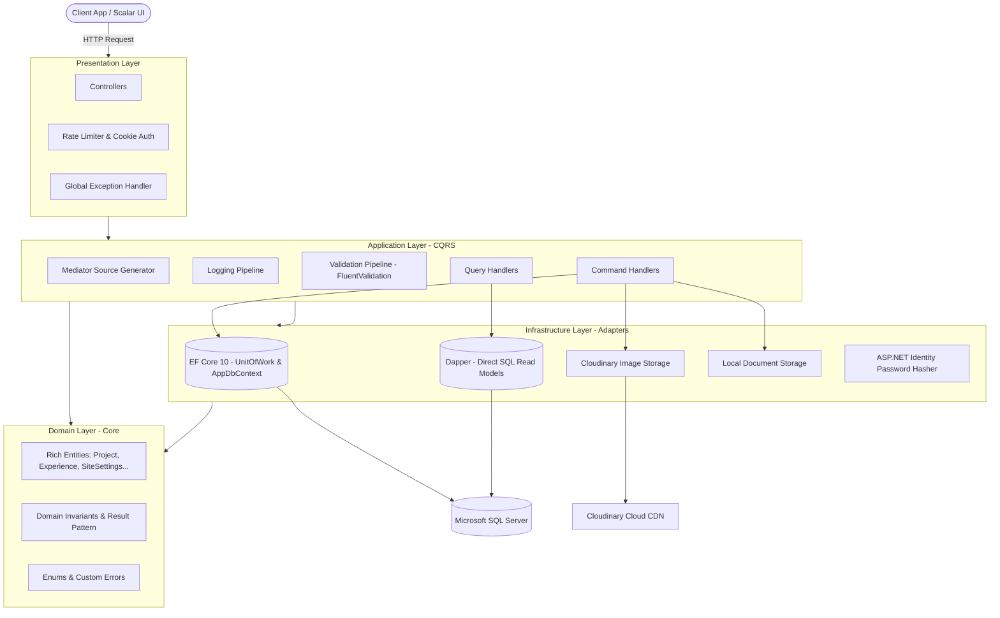

<div align="center">

# 🚀 Portfolio API

**A High-Performance, Enterprise-Grade Backend API Engineered with .NET 10, Clean Architecture, and CQRS.**

[](https://dotnet.microsoft.com/)
[](https://learn.microsoft.com/en-us/dotnet/csharp/)
[](https://blog.cleancoder.com/uncle-bob/2012/08/13/the-clean-architecture.html)
[](https://xunit.net/)
[](https://scalar.com/)
[](LICENSE)

[Explore API Docs](#-api-documentation--usage) • [Key Features](#-key-features) • [Architecture Deep Dive](#-architecture--tech-stack) • [Getting Started](#-getting-started--prerequisites) • [Testing](#-testing)

</div>

---

## 📖 Overview / About The Project

The **Portfolio API** is a production-ready, highly optimized backend platform designed to power modern personal portfolios and developer showcases. It provides a robust, decoupled headless Content Management System (CMS) that delivers public portfolio content at lightning speed while offering full administrative control over projects, credentials, work history, skill taxonomy, media assets, and site identity.

### 💡 The Problem & Motivation
Traditional portfolio templates tightly couple content, business logic, and presentation, resulting in brittle deployments, sluggish database interactions, and cumbersome content updates. This project demonstrates how modern enterprise .NET design principles can be applied to personal portfolio infrastructure:
- **Zero-Allocation Execution:** Built with compile-time source-generated mediation (`Mediator`) to eliminate runtime reflection overhead.
- **Hybrid Data Access:** Combines **Entity Framework Core 10** for rich transactional command modeling with **Dapper** for high-throughput, raw SQL query execution with SQL Server window functions.
- **Bulletproof Reliability:** Backed by **710 automated unit tests** enforcing strict domain invariants and application behaviors.

```
+----------------------------------------------------------------------------------------------------+
|                                      PORTFOLIO API ECOSYSTEM                                       |
|                                                                                                    |
|  [ Modern Web Client ] <==== Cookie Auth & REST ====> [ Portfolio API (.NET 10) ]                  |
|  (Angular / React / Next.js)                                     |                                 |
|                                         +------------------------+------------------------+        |
|                                         |                                                 |        |
|                                         v                                                 v        |
|                              [ MS SQL Server 2022 ]                              [ Cloudinary CDN ]|
|                              (EF Core Write + Dapper Read)                       (Images & Covers) |
+----------------------------------------------------------------------------------------------------+
```

> 📷 **Dashboard & Documentation Preview:**  
> When running locally in development mode, access the interactive dark-mode Scalar documentation UI at `http://localhost:5211/scalar/v1`.

---

## ✨ Key Features

### 👤 For Recruiters & Public Visitors
- 🎯 **Interactive Project Showcase:** Fast, paginated retrieval of showcase projects complete with SEO-optimized human-readable slugs, live links, GitHub URLs, tags, and multi-image galleries.
- 🗂️ **Skill Matrix:** Dynamic categorization of technical proficiencies across Languages, Frameworks, Databases, Tools, and Other competencies.
- 💼 **Timeline & Experience Tracking:** Rich chronological history detailing Full-Time, Part-Time, Contract, Freelance, and Internship roles.
- 📜 **Verified Certifications:** Showcase of credentials, certifications, issuing bodies, and issue dates with direct image proofs.
- 📄 **Curriculum Vitae (CV) Delivery:** Dedicated streaming endpoint (`/api/cv/download`) delivering the author's latest PDF resume directly with proper MIME typing.
- 🌐 **Contact & Freelance Presence:** Centralized repository of social contact links and freelance profile ratings (Upwork, Freelancer, Fiverr).

### 🛠️ For Engineers & Administrators
- 🔐 **Hardened Cookie Authentication:** Secure HTTP-only, SameSite=None, Sliding-expiration session cookie authentication without HTML redirect quirks on REST endpoints.
- 🛡️ **Tiered Rate Limiting:** Custom IP and Identity-based sliding/fixed window rate limiters (Protection against brute-force login attacks and public API scraping).
- ⚡ **Hybrid CQRS Persistence:** 
  - **Write Pipeline:** EF Core 10 with Unit of Work, encapsulated domain state, and Fluent API mapping.
  - **Read Pipeline:** Dapper executing CTE queries with SQL Server window functions (`COUNT(*) OVER()`) and `OFFSET...FETCH` pagination in a single roundtrip.
- ☁️ **Cloudinary Media Pipeline:** Automated multi-image cloud uploads, transformations, and remote asset deletions.
- 🚨 **RFC 7807 Standardized Errors:** Native ASP.NET Core `IExceptionHandler` pipeline emitting consistent `ProblemDetails` and validation dictionaries with distributed Trace IDs.
- 📜 **Structured High-Speed Logging:** Serilog pipeline configured with Async sinks, Console output, and size-capped rolling JSON files enriched with machine names and thread identifiers.

---

## 🏗️ Architecture & Tech Stack

The solution follows **Clean Architecture** (Ports & Adapters / Onion Architecture) and strictly adheres to Domain-Driven Design (DDD) tactical patterns and CQRS (Command Query Responsibility Segregation).

### High-Level Architecture Flow



### Technology Breakdown

| Component | Technology | Rationale |
| :--- | :--- | :--- |
| **Runtime & Language** | **.NET 10 (C# 13)** | Cutting-edge runtime performance, JIT optimizations, native AOT compatibility, and modern C# pattern matching. |
| **Mediation & CQRS** | **Mediator (Martin Ullrich)** | Compile-time source-generated mediator (zero reflection, zero runtime heap allocations compared to traditional MediatR). |
| **Write Model (ORM)** | **Entity Framework Core 10** | Robust change tracking, migration tooling, backing-field encapsulation, and relational mapping. |
| **Read Model (Micro-ORM)** | **Dapper 2.1** | Raw SQL performance for complex joins, window functions, and zero-overhead DTO materialization. |
| **Validation** | **FluentValidation 12** | Expressive, strongly-typed business validation intercepted automatically via mediator pipeline behaviors. |
| **API Documentation** | **Scalar & OpenAPI 3.0** | Modern, interactive, dark-mode developer documentation UI embedded natively into ASP.NET Core 10. |
| **Logging** | **Serilog (Async + Compact JSON)** | Structured event emission with async non-blocking file and console sinks, enriched with machine and thread IDs. |
| **Storage & Assets** | **CloudinaryDotNet + Local IO** | Automated cloud-based image hosting/transformation paired with secure local file streaming for PDF resumes. |
| **Security** | **ASP.NET Core Cookies + PBKDF2** | Safe, stateful credential sessions and cryptographic hashing via `PasswordHasher<User>`. |
| **Dependency Injection** | **Scrutor** | Assembly scanning for marker interfaces (`IScopedMark`, `ISingletonMark`) to keep DI registration clean and clean-cut. |
| **Testing** | **xUnit + FluentAssertions + FakeItEasy** | High-speed unit testing suite with readable assertion syntax and dynamic mock generation. |

---

## 📂 Project Structure

```
Portfolio/
├── 📁 API/                              # Presentation Layer (ASP.NET Core Web API)
│   ├── 📁 Controllers/                  # 11 REST Controllers (Projects, Skills, Auth, etc.)
│   ├── 📁 Extenstions/                  # Service configuration extensions (Rate Limiting)
│   ├── 📁 Middlewares/                  # RFC 7807 Global Exception Handling
│   ├── 📁 Properties/                   # Launch settings & hosting profiles
│   ├── 📄 Program.cs                    # Application composition root & middleware pipeline
│   ├── 📄 appsettings.json              # Base application configuration
│   ├── 📄 appsettings.Development.json  # Dev configuration (CORS, Serilog, local DB)
│   └── 📄 appsettings.Production.json   # Production logging and environment config
│
├── 📁 Application/                      # Application Layer (CQRS Orchestration)
│   ├── 📁 Behaviors/                    # Mediator pipeline behaviors (Logging, FluentValidation)
│   ├── 📁 Features/                     # Vertical slice feature folders
│   │   ├── 📁 About Item/               # Highlights / About me slices
│   │   ├── 📁 Authentication/           # Login / Logout commands & DTOs
│   │   ├── 📁 Certificate/              # Certification CRUD operations
│   │   ├── 📁 Contact Link/             # Social media & contact links
│   │   ├── 📁 CV/                       # Resume queries & upload commands
│   │   ├── 📁 Experience/               # Work history commands & queries
│   │   ├── 📁 Freelance Profile/        # Upwork/Freelancer profile management
│   │   ├── 📁 Project/                  # Project CRUD, slug queries, pagination
│   │   ├── 📁 Project Images/           # Cloudinary asset link/unlink
│   │   ├── 📁 Site Settings/            # Global portfolio metadata & profile picture
│   │   └── 📁 Skill/                    # Skill taxonomy operations
│   ├── 📁 Interfaces/                   # Segregated repository and service contracts
│   ├── 📁 Options/                      # Strongly-typed option models (SiteSettingsOptions)
│   └── 📁 Shared/                       # Pagination models (PagedResult) & common DTOs
│
├── 📁 Domain/                           # Enterprise Domain Layer (Pure C#, Zero Dependencies)
│   ├── 📁 Constants/                    # Maximum length constraints & domain invariants
│   ├── 📁 Entities/                     # Rich DDD entities with encapsulated state & factories
│   ├── 📁 Enums/                        # Domain enums (ExperienceType, SkillType, UserRole)
│   ├── 📁 Errors/                       # Strongly-typed domain error catalogs
│   └── 📁 Shared/                       # Result<T> and Error domain primitives
│
├── 📁 Infrastructure/                   # Infrastructure Layer (External Adapters)
│   ├── 📁 Data/
│   │   ├── 📁 Dapper/                   # High-performance read-side repositories & SQL queries
│   │   ├── 📁 EF Core/                  # Write-side DbContext, Fluent API mappings, Unit of Work
│   │   └── 📁 Initializer/              # Database initialization & default SiteSettings seeder
│   ├── 📁 Migrations/                   # EF Core database migrations & snapshot
│   └── 📁 Services/                     # Cloudinary, Local Document Storage, Password Hasher
│
├── 📁 Application.Tests/                # 502 Unit Tests for Handlers & FluentValidation rules
├── 📁 Domain.Tests/                     # 208 Unit Tests for Domain invariants, rules, & slug generation
├── 📁 Infrastructure.Tests/             # Integration & adapter tests
├── 📁 Logs/                             # Daily rolling structured application log files
└── 📄 Portfolio.slnx                    # Modern .NET solution file
```

---

## 🚀 Getting Started / Prerequisites

### Prerequisites

Ensure you have the following installed on your machine:
- **[.NET 10 SDK](https://dotnet.microsoft.com/download/dotnet/10.0)** (Version `10.0.301` or newer)
- **[Microsoft SQL Server](https://www.microsoft.com/en-us/sql-server/sql-server-downloads)** (2019+ or LocalDB / Express / Docker SQL Server)
- **[Git](https://git-scm.com/)**
- *(Optional)* A free **[Cloudinary](https://cloudinary.com/)** account for image hosting and media management.

---

### Step 1: Clone the Repository

```bash
git clone https://github.com/ahmed-hamada-hassan/My-Portfolio.git
cd My-Portfolio
```

---

### Step 2: Configure Environment & Secrets

The API utilizes ASP.NET Core `appsettings.json` and User Secrets. In development, you can use `.NET User Secrets` or add a connection string to `API/appsettings.Development.json`.

#### Option A: Using .NET Secret Manager (Recommended)
Navigate to the `API` project directory and initialize your secrets:

```bash
cd API

# Configure SQL Server Connection String
dotnet user-secrets set "ConnectionStrings:DefaultConnection" "Server=localhost;Database=PortfolioDb;Trusted_Connection=True;TrustServerCertificate=True;"

# Configure Cloudinary Credentials
dotnet user-secrets set "Cloudinary:CloudName" "your-cloud-name"
dotnet user-secrets set "Cloudinary:ApiKey" "your-api-key"
dotnet user-secrets set "Cloudinary:ApiSecret" "your-api-secret"
```

#### Option B: Using `appsettings.Development.json`
Alternatively, edit `API/appsettings.Development.json`:

```json
{
  "ConnectionStrings": {
    "DefaultConnection": "Server=localhost;Database=PortfolioDb;Trusted_Connection=True;TrustServerCertificate=True;"
  },
  "Cloudinary": {
    "CloudName": "your-cloud-name",
    "ApiKey": "your-api-key",
    "ApiSecret": "your-api-secret"
  },
  "CORS": {
    "AllowedOrigins": [
      "http://localhost:3000",
      "https://localhost:3000",
      "http://localhost:4200",
      "https://localhost:4200"
    ]
  }
}
```

---

### Step 3: Apply Database Migrations

Apply the Entity Framework Core migrations to create and configure the database:

```bash
# From the root directory
dotnet ef database update --project Infrastructure --startup-project API
```

> 💡 **Automatic Seed Data:** On first boot, `SiteSettingsInitializer` will automatically seed the baseline Site Settings if not already initialized.

---

### Step 4: Run the Application

```bash
# From the root directory
dotnet run --project API
```

Once running, the application will listen on:
- **HTTP:** `http://localhost:5211`
- **HTTPS:** `https://localhost:7198` *(or ports specified in launchSettings.json)*
- **Interactive Scalar Docs:** `http://localhost:5211/scalar/v1`

---

## 📡 API Documentation / Usage

Interactive documentation is served via **Scalar** at:
👉 `http://localhost:5211/scalar/v1` (Development Environment)

### Core Endpoints Matrix

| Module | Method | Endpoint | Access | Description |
| :--- | :---: | :--- | :---: | :--- |
| **Auth** | `POST` | `/api/auth/login` | Public (Rate Limited) | Authenticate admin & issue HTTP-only cookie |
| **Auth** | `POST` | `/api/auth/logout` | Admin | Revoke authentication session |
| **Projects** | `GET` | `/api/projects?page=1&pageSize=10` | Public | Paginated list of projects with cover images & tags |
| **Projects** | `GET` | `/api/projects/{slug}` | Public | Detailed project view by unique slug |
| **Projects** | `POST` | `/api/projects/admin` | Admin | Create project with form metadata |
| **Projects** | `PATCH`| `/api/projects/{id}/ongoing/admin` | Admin | Mark project as actively ongoing |
| **Images** | `POST` | `/api/projects/{id}/images/admin` | Admin | Upload gallery images to Cloudinary |
| **Skills** | `GET` | `/api/skills?type=Language` | Public | Filter skills by category enum |
| **Experience** | `GET` | `/api/experiences` | Public | Retrieve full career timeline |
| **Certificates**| `GET` | `/api/certificates` | Public | List certifications with badge proofs |
| **CV** | `GET` | `/api/cv/download` | Public | Stream uploaded PDF resume directly |
| **Settings** | `GET` | `/api/site-settings` | Public | Retrieve site title, profile image, work availability |

### Example cURL Commands

#### 1. Retrieve Paginated Projects (Public)
```bash
curl -X GET "http://localhost:5211/api/projects?page=1&pageSize=6" \
     -H "Accept: application/json"
```

#### 2. Admin Authentication
```bash
curl -X POST "http://localhost:5211/api/auth/login" \
     -H "Content-Type: application/json" \
     -d '{
       "email": "admin@portfolio.local",
       "password": "SecurePassword123!"
     }' \
     -c cookies.txt
```

#### 3. Create a Project (Admin with Session Cookie)
```bash
curl -X POST "http://localhost:5211/api/projects/admin" \
     -b cookies.txt \
     -F "title=Enterprise Cloud Telemetry" \
     -F "description=Distributed telemetry ingestion engine handling millions of traces." \
     -F "startDate=2024-01-15" \
     -F "githubUrl=https://github.com/example/telemetry" \
     -F "liveUrl=https://telemetry.example.com"
```

---

## 🧪 Testing

The solution emphasizes enterprise software quality, featuring **710 automated unit tests** with a **100% pass rate** across domain rules, validation logic, and CQRS handlers.

### Test Breakdown

- **`Domain.Tests` (208 tests):**
  - Validation of entity invariants (Project, Certificate, Experience, SiteSettings).
  - Slug generation regex and collision prevention algorithms.
  - Date ordering logic (start date vs. end date constraints).
  - Aggregate root encapsulation and image collection boundaries.
- **`Application.Tests` (502 tests):**
  - Isolated command and query handler behavior using `FakeItEasy` mocking.
  - Comprehensive FluentValidation validation rule suites.
  - Boundary assertions using `FluentAssertions`.

### Running Tests Locally

```bash
# Run all tests across the entire solution
dotnet test

# Run tests with detailed test results summary
dotnet test --logger "console;verbosity=normal"

# Run tests with code coverage analysis
dotnet test --collect:"XPlat Code Coverage"
```


---

## 🤝 Contributing

Contributions, issues, and feature requests are welcome!

1. **Fork the Repository**
2. **Create your Feature Branch:**
   ```bash
   git checkout -b feature/AmazingFeature
   ```
3. **Commit your Changes:**
   ```bash
   git commit -m "feat: Add new awesome capability"
   ```
4. **Run the Test Suite:**
   ```bash
   dotnet test
   ```
5. **Push to the Branch:**
   ```bash
   git push origin feature/AmazingFeature
   ```
6. **Open a Pull Request**

Please ensure all new code adheres to the existing Clean Architecture principles and includes corresponding unit tests in `Domain.Tests` or `Application.Tests`.

---

## 📄 License

This project is licensed under the **MIT License** — see the [LICENSE](LICENSE) file for details.

---

<div align="center">
  <sub>Engineered with precision by <strong>Ahmed Hamada</strong>. Powered by .NET 10.</sub>
</div>
