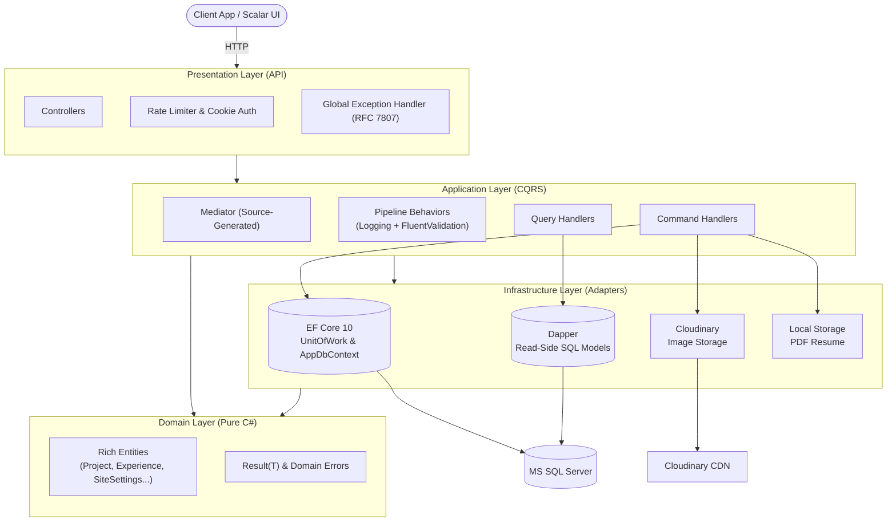

<div align="center">

<h1>🚀 Portfolio API</h1>

<p><strong>A High-Performance, Enterprise-Grade Backend API<br/>built with .NET 10, Clean Architecture, and CQRS.</strong></p>

[](https://dotnet.microsoft.com/)
[](https://learn.microsoft.com/en-us/dotnet/csharp/)
[](https://blog.cleancoder.com/uncle-bob/2012/08/13/the-clean-architecture.html)
[](https://xunit.net/)
[](https://scalar.com/)
[](LICENSE)

<p>
  <a href="#-about-the-project">About</a> •
  <a href="#-key-features">Features</a> •
  <a href="#%EF%B8%8F-architecture">Architecture</a> •
  <a href="#-project-structure">Structure</a> •
  <a href="#-getting-started">Getting Started</a> •
  <a href="#-api-reference">API Reference</a> •
  <a href="#-testing">Testing</a> •
  <a href="#-contributing">Contributing</a> •
  <a href="#-license">License</a>
</p>

</div>

---

## 📖 About The Project

**Portfolio API** is a production-ready, headless CMS backend designed to power modern developer portfolios. It decouples content management from presentation, enabling any frontend (Angular, React, Next.js) to consume structured portfolio data via a clean REST API.

### The Problem & Motivation

Traditional portfolio templates tightly couple content, business logic, and UI — resulting in brittle deployments, sluggish database queries, and painful content updates. This project applies modern enterprise .NET patterns to personal portfolio infrastructure:

| Pain Point | Solution |
| :--- | :--- |
| Runtime reflection overhead | Compile-time source-generated `Mediator` (zero allocations) |
| Slow paginated queries | `Dapper` + SQL Server window functions in a single round-trip |
| Brittle domain rules | 710 automated unit tests enforcing strict invariants |
| Unstructured media | Cloudinary CDN pipeline with automated transforms & cleanup |

---

## ✨ Key Features

<details>
<summary><strong>👤 Public / Recruiter-Facing</strong></summary>
<br/>

- 🎯 **Project Showcase** — Paginated, SEO-friendly projects with slugs, tags, live URLs, GitHub links, and image galleries.
- 🗂️ **Skill Matrix** — Dynamic skill categorization across Languages, Frameworks, Databases, Tools, and more.
- 💼 **Career Timeline** — Full work history with employment types (Full-Time, Contract, Freelance, Internship).
- 📜 **Certifications** — Verified credentials with issuing body, date, and image proof.
- 📄 **CV Download** — Streaming PDF endpoint (`/api/cv/download`) with proper MIME typing.
- 🌐 **Contact & Freelance Profiles** — Social links and ratings from Upwork, Freelancer, and Fiverr.

</details>

<details>
<summary><strong>🛠️ Admin / Engineer-Facing</strong></summary>
<br/>

- 🔐 **Cookie Authentication** — HTTP-only, `SameSite=None`, sliding-expiration sessions — no redirect quirks on REST endpoints.
- 🛡️ **Tiered Rate Limiting** — IP-based and Identity-based sliding/fixed-window limiters against brute-force and scraping.
- ⚡ **Hybrid CQRS Persistence** — EF Core 10 for writes (Unit of Work), Dapper for reads (raw SQL CTEs).
- ☁️ **Cloudinary Media Pipeline** — Cloud image uploads, transformations, and remote asset deletions.
- 🚨 **RFC 7807 Problem Details** — Consistent `ProblemDetails` responses with distributed Trace IDs.
- 📋 **Structured Logging** — Serilog with async sinks, size-capped rolling JSON files, machine names, and thread IDs.

</details>

---

## 🏗️ Architecture

The solution follows **Clean Architecture** (Onion / Ports & Adapters) with strict adherence to **Domain-Driven Design (DDD)** tactical patterns and **CQRS**.



### Technology Stack

| Layer | Technology | Why |
| :--- | :--- | :--- |
| **Runtime** | .NET 10 / C# 13 | Latest performance, JIT improvements, native AOT |
| **CQRS / Mediation** | Mediator (Martin Ullrich) | Zero-reflection, source-generated — no MediatR heap overhead |
| **ORM (Writes)** | Entity Framework Core 10 | Change tracking, migrations, Fluent API mapping |
| **Micro-ORM (Reads)** | Dapper 2.1 | Raw SQL, window functions, zero-overhead DTO mapping |
| **Validation** | FluentValidation 12 | Strongly-typed rules wired into the mediator pipeline |
| **API Docs** | Scalar + OpenAPI 3.0 | Modern dark-mode interactive docs, native ASP.NET Core |
| **Logging** | Serilog (Async + Compact JSON) | Non-blocking sinks, structured events, machine/thread enrichment |
| **Media Storage** | CloudinaryDotNet + Local IO | Cloud image hosting & transforms + local PDF streaming |
| **Auth & Security** | ASP.NET Core Cookies + PBKDF2 | Stateful sessions + `PasswordHasher<User>` |
| **DI Registration** | Scrutor | Assembly scanning via marker interfaces (`IScopedMark`, `ISingletonMark`) |
| **Testing** | xUnit + FluentAssertions + FakeItEasy | Fast suite, readable assertions, dynamic mocks |

---

## 📂 Project Structure

```
Portfolio/
├── API/                              # Presentation Layer (ASP.NET Core Web API)
│   ├── Controllers/                  # 11 REST Controllers (Projects, Skills, Auth, CV...)
│   ├── Extensions/                   # Service configuration extensions (Rate Limiting)
│   ├── Middlewares/                  # RFC 7807 Global Exception Handler
│   ├── Program.cs                    # Composition root & middleware pipeline
│   ├── appsettings.json              # Base configuration
│   ├── appsettings.Development.json  # Dev config (CORS, Serilog, local DB)
│   └── appsettings.Production.json   # Production logging & environment config
│
├── Application/                      # Application Layer (CQRS Orchestration)
│   ├── Behaviors/                    # Pipeline behaviors (Logging, Validation)
│   ├── Features/                     # Vertical slice feature folders
│   │   ├── About Item/               # Highlights / About me slices
│   │   ├── Authentication/           # Login / Logout commands & DTOs
│   │   ├── Certificate/              # Certification CRUD
│   │   ├── Contact Link/             # Social media & contact links
│   │   ├── CV/                       # Resume queries & upload commands
│   │   ├── Experience/               # Work history commands & queries
│   │   ├── Freelance Profile/        # Upwork/Freelancer profile management
│   │   ├── Project/                  # Project CRUD, slug queries, pagination
│   │   ├── Project Images/           # Cloudinary asset link/unlink
│   │   ├── Site Settings/            # Global portfolio metadata & profile picture
│   │   └── Skill/                    # Skill taxonomy operations
│   ├── Interfaces/                   # Repository & service contracts
│   ├── Options/                      # Strongly-typed option models
│   └── Shared/                       # PagedResult & common DTOs
│
├── Domain/                           # Domain Layer (Pure C#, Zero External Dependencies)
│   ├── Constants/                    # Length constraints & domain invariants
│   ├── Entities/                     # Rich DDD entities with factory methods
│   ├── Enums/                        # ExperienceType, SkillType, UserRole...
│   ├── Errors/                       # Strongly-typed error catalogs
│   └── Shared/                       # Result<T> & Error primitives
│
├── Infrastructure/                   # Infrastructure Layer (External Adapters)
│   ├── Data/
│   │   ├── Dapper/                   # Read-side repositories & raw SQL
│   │   ├── EF Core/                  # Write-side DbContext, Fluent API, Unit of Work
│   │   └── Initializer/              # DB init & SiteSettings seeder
│   ├── Migrations/                   # EF Core migrations & snapshot
│   └── Services/                     # Cloudinary, Local Storage, Password Hasher
│
├── Application.Tests/                # 502 Unit Tests — Handlers & Validation rules
├── Domain.Tests/                     # 208 Unit Tests — Domain invariants & slug logic
├── Logs/                             # Daily rolling structured log files
└── Portfolio.slnx                    # Solution file
```

---

## 🚀 Getting Started

### Prerequisites

| Tool | Version | Link |
| :--- | :--- | :--- |
| .NET SDK | 10.0.301+ | [Download](https://dotnet.microsoft.com/download/dotnet/10.0) |
| SQL Server | 2019+ / LocalDB / Express | [Download](https://www.microsoft.com/en-us/sql-server/sql-server-downloads) |
| Git | Latest | [Download](https://git-scm.com/) |
| Cloudinary Account | *(Optional)* | [Sign Up Free](https://cloudinary.com/) |

### 1. Clone the Repository

```bash
git clone https://github.com/ahmed-hamada-hassan/My-Portfolio.git
cd My-Portfolio
```

### 2. Configure Secrets

> **Tip:** Use the **.NET Secret Manager** (Option A) to keep credentials out of source control.

**Option A — .NET Secret Manager (Recommended):**

```bash
cd API

dotnet user-secrets set "ConnectionStrings:DefaultConnection" \
  "Server=localhost;Database=PortfolioDb;Trusted_Connection=True;TrustServerCertificate=True;"

dotnet user-secrets set "Cloudinary:CloudName" "your-cloud-name"
dotnet user-secrets set "Cloudinary:ApiKey"    "your-api-key"
dotnet user-secrets set "Cloudinary:ApiSecret" "your-api-secret"
```

**Option B — `appsettings.Development.json`:**

> **Warning:** Never commit real credentials to version control. Add `appsettings.Development.json` to `.gitignore` if using this option.

```json
{
  "ConnectionStrings": {
    "DefaultConnection": "Server=localhost;Database=PortfolioDb;Trusted_Connection=True;TrustServerCertificate=True;"
  },
  "Cloudinary": {
    "CloudName": "your-cloud-name",
    "ApiKey": "your-api-key",
    "ApiSecret": "your-api-secret"
  },
  "CORS": {
    "AllowedOrigins": [
      "http://localhost:3000",
      "http://localhost:4200"
    ]
  }
}
```

### 3. Apply Database Migrations

```bash
# Run from the solution root
dotnet ef database update --project Infrastructure --startup-project API
```

> **Note:** On first boot, `SiteSettingsInitializer` automatically seeds baseline Site Settings.

### 4. Run the Application

```bash
dotnet run --project API
```

The API will be available at:

| Endpoint | URL |
| :--- | :--- |
| HTTP | `http://localhost:5211` |
| HTTPS | `https://localhost:7198` |
| Interactive API Docs (Scalar) | `http://localhost:5211/scalar/v1` |

---

## 📡 API Reference

Interactive documentation is available via **Scalar** at `http://localhost:5211/scalar/v1` when running in development mode.

### Endpoint Overview

| Module | Method | Endpoint | Auth | Description |
| :--- | :---: | :--- | :---: | :--- |
| **Auth** | `POST` | `/api/auth/login` | Public | Authenticate & issue HTTP-only session cookie |
| **Auth** | `POST` | `/api/auth/logout` | 🔐 Admin | Revoke current session |
| **Projects** | `GET` | `/api/projects?page=1&pageSize=10` | Public | Paginated project list |
| **Projects** | `GET` | `/api/projects/{slug}` | Public | Project detail by slug |
| **Projects** | `POST` | `/api/projects/admin` | 🔐 Admin | Create a new project |
| **Projects** | `PATCH` | `/api/projects/{id}/ongoing/admin` | 🔐 Admin | Mark project as ongoing |
| **Images** | `POST` | `/api/projects/{id}/images/admin` | 🔐 Admin | Upload gallery images to Cloudinary |
| **Skills** | `GET` | `/api/skills?type=Language` | Public | Filter skills by category |
| **Experience** | `GET` | `/api/experiences` | Public | Full career timeline |
| **Certificates** | `GET` | `/api/certificates` | Public | Certifications with badge proofs |
| **CV** | `GET` | `/api/cv/download` | Public | Stream PDF resume |
| **Site Settings** | `GET` | `/api/site-settings` | Public | Site metadata & profile image |

### Example Requests

<details>
<summary><strong>GET — Paginated Projects</strong></summary>

```bash
curl -X GET "http://localhost:5211/api/projects?page=1&pageSize=6" \
     -H "Accept: application/json"
```

</details>

<details>
<summary><strong>POST — Admin Login</strong></summary>

```bash
curl -X POST "http://localhost:5211/api/auth/login" \
     -H "Content-Type: application/json" \
     -d '{"email": "admin@portfolio.local", "password": "SecurePassword123!"}' \
     -c cookies.txt
```

</details>

<details>
<summary><strong>POST — Create Project (Admin)</strong></summary>

```bash
curl -X POST "http://localhost:5211/api/projects/admin" \
     -b cookies.txt \
     -F "title=Enterprise Cloud Telemetry" \
     -F "description=Distributed telemetry ingestion engine handling millions of traces." \
     -F "startDate=2024-01-15" \
     -F "githubUrl=https://github.com/example/telemetry" \
     -F "liveUrl=https://telemetry.example.com"
```

</details>

---

## 🧪 Testing

The solution includes **710 automated unit tests** with a **100% pass rate**.

| Test Project | Tests | Scope |
| :--- | :---: | :--- |
| `Domain.Tests` | 208 | Entity invariants, slug generation, date ordering, aggregate boundaries |
| `Application.Tests` | 502 | Command/query handler behavior, FluentValidation rules, boundary assertions |

### Running Tests

```bash
# Run the full test suite
dotnet test

# Run with detailed output
dotnet test --logger "console;verbosity=normal"

# Run with code coverage
dotnet test --collect:"XPlat Code Coverage"
```

---

## 🤝 Contributing

Contributions, issues, and feature requests are welcome!

1. **Fork** the repository
2. **Create a feature branch:**
   ```bash
   git checkout -b feature/your-feature-name
   ```
3. **Commit** your changes using [Conventional Commits](https://www.conventionalcommits.org/):
   ```bash
   git commit -m "feat: add new capability"
   ```
4. **Run the test suite** and ensure all tests pass:
   ```bash
   dotnet test
   ```
5. **Push** your branch and **open a Pull Request**

> **Important:** All contributions must follow Clean Architecture principles and include corresponding unit tests in `Domain.Tests` or `Application.Tests`.

---

## 📄 License

This project is licensed under the **MIT License** — see the [LICENSE](LICENSE) file for full details.

---

<div align="center">
  <sub>Engineered with precision by <strong>Ahmed Hamada</strong> · Powered by .NET 10</sub>
</div>
